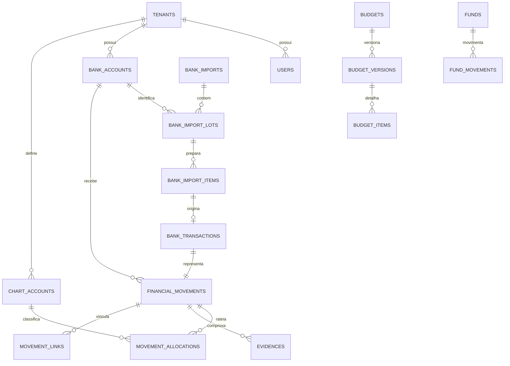

# Modelo de dados

## 1. Visão principal



## 2. Importação bancária

### `bank_imports`

Representa o arquivo recebido. O hash é único dentro do tenant. Um arquivo pode conter vários lotes/contas do mesmo tenant.

### `bank_import_lots`

Representa um lote CNAB vinculado a uma conta cadastrada. Nenhum saldo inicial ou final é persistido.

### `bank_import_items`

Área persistida de prévia. Cada registro pode ser `NEW`, `POSSIBLE_DUPLICATE`, `CONFIRMED_DUPLICATE`, `ERROR`, `READY` ou `IMPORTED`.

### `bank_transactions`

Registro confirmado e imutável. Guarda campos normalizados relevantes e referências técnicas à linha de origem. O arquivo completo continua no R2.

## 3. Livro financeiro

### `financial_movements`

Campos principais:

- origem `BANK` ou `MANUAL`;
- conta bancária;
- número anual por tenant;
- data contábil;
- competência;
- débito/crédito;
- valor em centavos;
- descrição e justificativa;
- estado `ACTIVE` ou `CANCELLED`.

Movimento `BANK` possui exatamente uma transação bancária. Movimento `MANUAL` não possui transação.

### `movement_allocations`

Classifica o movimento. O total das linhas ativas deve ser idêntico ao valor do movimento. A API garante essa invariável na mesma transação da auditoria.

Percentuais são armazenados opcionalmente em partes por milhão (`percentage_ppm`), onde 100% equivale a `1_000_000`. O valor em centavos continua sendo a fonte de cálculo.

### `movement_links`

Relaciona movimentos, inicialmente para transferências internas. Débito e crédito vinculados permanecem em suas contas e são neutros no resultado.

## 4. Identidade e sequência

Chaves primárias públicas são UUIDs. `movement_sequences` mantém a última sequência utilizada por tenant e exercício. Um trigger atribui o número no formato `#YYNNNN` durante a inserção.

## 5. Integridade multi-tenant

Além de toda tabela de negócio possuir `tenant_id`, referências críticas usam o par:

```text
(tenant_id, entidade_id)
```

Isso impede, no próprio banco, associar uma importação do condomínio A a uma conta do condomínio B.

## 6. Imutabilidade

Triggers impedem `UPDATE` e `DELETE` em `bank_transactions`. Campos bancários essenciais do movimento de origem `BANK` também não podem ser alterados.

Classificação, justificativa e evidências ficam fora do registro bancário bruto.

## 7. Regras não expressáveis apenas com CHECK

As seguintes regras são aplicadas pelo domínio e cobertas por testes de integração:

- soma dos rateios igual ao movimento;
- soma de percentuais igual a 100%;
- rateio usa um único modo;
- nenhuma alteração em período fechado;
- lados de transferência têm mesmo valor e sentidos opostos;
- saldo inicial não muda após o primeiro movimento;
- confirmação de importação cria transação, movimento e audit log atomicamente.
